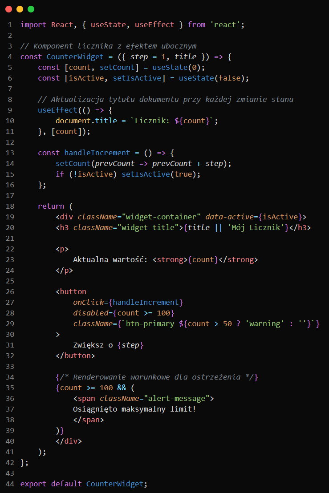

<div align="center">

# 🌿 Willow Theme

**A sleek, immersive dark theme crafted with vivid willow green accents, complemented by electric turquoise and deep purple highlights.**

[](https://marketplace.visualstudio.com/items?itemName=RaulWierzbiski.willow-theme)
[](https://marketplace.visualstudio.com/items?itemName=RaulWierzbiski.willow-theme)
[](LICENSE)

<br/>



<br/>

*Designed for late-night focus, optimal contrast, and modern developer aesthetics.*

</div>

---

## ✨ Features

- 🖤 **Deep Onyx Canvas (`#0a0a0a`)**: A true deep-dark background that reduces eye strain and looks breathtaking on OLED and high-contrast displays.
- 🌿 **Signature Willow Accents**: Distinctive neon green (`#03e28e`), turquoise cyan (`#82dcff`), and soft purple (`#c678dd`) bring your code to life without visual clutter.
- 🌈 **Native Bracket Pair Colorization**: Colored bracket pairs and matching guide lines in alternating palette tones make complex nested structures effortless to navigate.
- 🚀 **Full Modern VS Code Integration**:
  - **Command Center**: Centered top search and quick action bar styled to match the dark aesthetic.
  - **Sticky Scroll**: Sticky class and function headers blend seamlessly at the top of your editor.
  - **Activity Bar Top Layout**: Full support for both traditional side bar and modern top-placed activity bars.
  - **Multi-Level Indent Guides**: Subtle guide lines showing nesting levels 1 through 6.
  - **AI & Inline Chat**: Styled windows for GitHub Copilot, interactive sessions, and inline prompts.
  - **Modern Diff Views**: Clean inline and gutter highlighting for git reviews.
- 🎯 **Advanced Semantic Highlighting**: Tailored syntax tokens for TypeScript, JavaScript, Python, Rust, Go, C#, HTML/CSS, JSON, and Markdown.

---

## 🎨 Color Palette

| Swatch | Color | Hex Code | Role in Willow |
|:---:|:---|:---:|:---|
| 🟢 | **Willow Green** | `#03e28e` | Primary accent, cursor, active tab border, buttons |
| 💠 | **Electric Turquoise** | `#82dcff` | Object properties, status bar text, secondary accents |
| 🟣 | **Willow Purple** | `#c678dd` | Decorators, special types, bracket pairs |
| 🟡 | **Golden Wheat** | `#e5c07b` | Keywords, classes, interfaces, storage |
| 🟠 | **Warm Amber** | `#d19a66` | Constants, numbers, read-only identifiers |
| 🔵 | **Sky Blue** | `#468dc7` | Functions, methods, standard calls |
| ⬛ | **Deep Onyx** | `#0a0a0a` | Editor, sidebar, and workbench background |

---

## 💡 Recommended Settings

For the ultimate experience with Willow, add the following optional settings to your `settings.json`:

```json
{
  "workbench.colorTheme": "willow",
  "editor.cursorBlinking": "smooth",
  "editor.cursorSmoothCaretAnimation": "on",
  "editor.bracketPairColorization.enabled": true,
  "editor.guides.bracketPairs": "active",
  "editor.stickyScroll.enabled": true,
  "editor.fontLigatures": true
}
```

---

## 📋 Changelog

See the **[CHANGELOG.md](https://github.com/Wierzba13/willow-theme/blob/main/CHANGELOG.md)** for a complete record of updates and release history.

---

## 🤝 Feedback & Contributions

Issues, feature requests, and suggestions are warmly welcome!
- 🐛 Found a bug or contrast issue? Open an issue on [GitHub Issues](https://github.com/Wierzba13/willow-theme/issues).
- ⭐ Enjoying the theme? Please consider leaving a **rating and review** on the [Visual Studio Marketplace](https://marketplace.visualstudio.com/items?itemName=RaulWierzbiski.willow-theme)!

---

<div align="center">

Crafted with care by [**Raul Wierzbiński**](https://github.com/Wierzba13) &bull; Released under the [MIT License](LICENSE)

</div>
